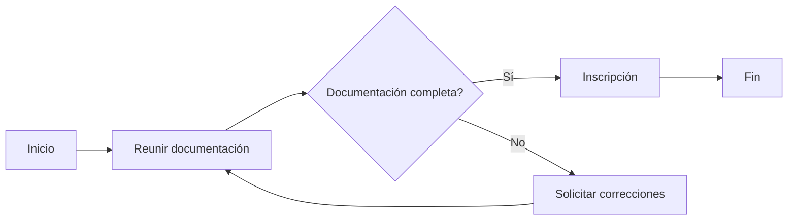

# Diagramas y herramientas

## 1. Definición

Los diagramas son representaciones gráficas que permiten visualizar cómo funciona un sistema, un proceso o una idea. Las herramientas sirven para crear y organizar esos diagramas de forma clara y ordenada.

## 2. Explicación desarrollada

En Modelos y Sistemas, los diagramas permiten representar relaciones, decisiones, flujos y estados. Esto ayuda a entender un problema sin necesidad de leer una gran cantidad de texto. Una buena representación visual facilita la comunicación entre estudiantes, profesores y equipos.

Las herramientas más comunes incluyen schematic tools, software de diagramación y tableros visuales. Si bien se pueden dibujar a mano, el uso de herramientas digitales mejora la claridad, la reutilización y la presentación.

## 3. Características principales

- Son visuales y fáciles de interpretar.
- Permiten resumir información compleja.
- Facilitan la comparación entre situaciones.
- Pueden usarse en análisis, diseño y documentación.

## 4. Objetivos y utilidad

- Comprender sistemas de manera intuitiva.
- Organizar ideas.
- Comunicar procesos eficientemente.
- Apoyar la elaboración de trabajos prácticos y exposiciones.

## 5. Ejemplo práctico

Un alumno quiere representar el proceso de inscripción a una escuela. Puede dibujar:

- ingreso del estudiante,
- revisión de documentación,
- aprobación o rechazo,
- inscripción final.

Esto se entiende más rápido con un diagrama que con una explicación escrita extensa.

## 6. Diagrama

## 7. Conclusión

Los diagramas y herramientas permiten transformar ideas abstractas en elementos claros y útiles para el análisis y la comunicación. Son un soporte esencial en la materia.

## Temas relacionados

- [Transición de estados](../transicion-de-estados/README.md)
- [Diagramas de flujo](../../7mo-anio/diagramas-de-flujo/README.md)
