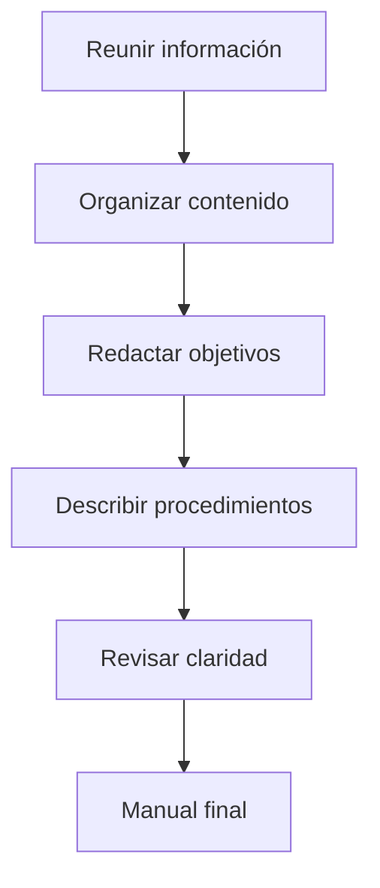

# Documentación y manuales

## 1. Definición

La documentación y los manuales son materiales que explican cómo funciona un sistema, cómo se usa un recurso o cómo se realiza una actividad de manera clara y ordenada.

## 2. Explicación desarrollada

La documentación es importante porque permite que una persona entienda un proceso sin necesidad de conocerlo de memoria. En un proyecto, los manuales ayudan a registrar objetivos, procedimientos, decisiones y resultados.

## 3. Características principales

- Está organizada por secciones.
- Usa lenguaje claro y ordenado.
- Sirve como referencia.
- Ayuda a la continuidad del trabajo.

## 4. Objetivos y utilidad

- Registrar información importante.
- Explicar procedimientos.
- Facilitar la consulta posterior.

## 5. Ejemplo práctico

Un manual escolar puede explicar:

- qué es una actividad,
- qué materiales se necesitan,
- qué pasos seguir,
- cómo evaluar el resultado.

## 6. Diagrama

## 7. Conclusión

La documentación es la base para comunicar y conservar el conocimiento. Sin ella, un proceso puede volverse difícil de entender o repetir.

## Temas relacionados

- [Diagramas y herramientas](../diagramas-y-herramientas/README.md)
- [Documentación técnica](../../documentacion/documentacion-tecnica.md)
