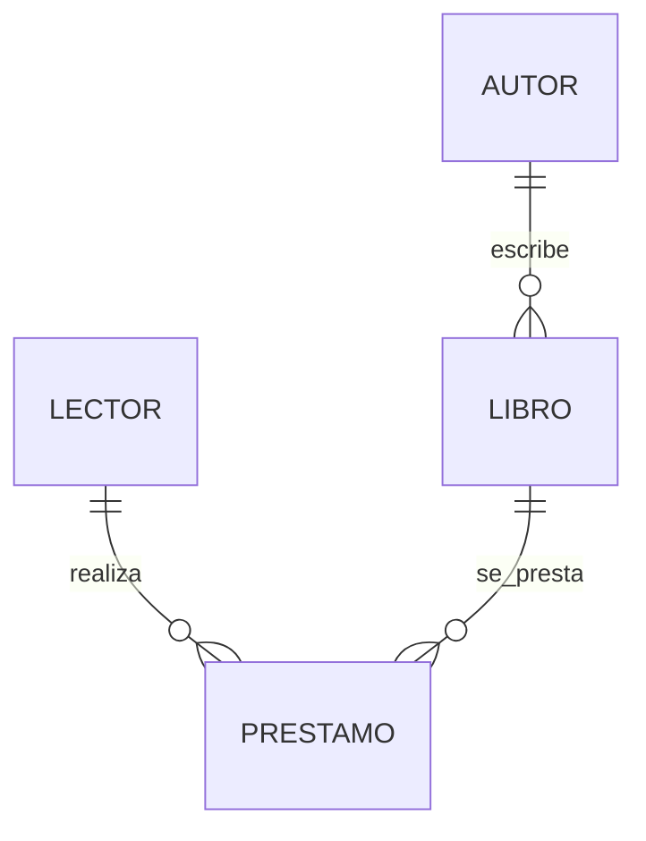

# Entidad-relación

## 1. Definición

Un diagrama entidad-relación (ER) muestra cómo se relacionan los distintos elementos de un sistema. Sirve para representar entidades, atributos y asociaciones entre ellas.

## 2. Explicación desarrollada

Las entidades son objetos o conceptos del mundo real. Por ejemplo, "alumno", "curso" o "profesor". Cada entidad tiene atributos, como nombre, edad o código. Las relaciones indican cómo interactúan entre sí.

Este tipo de diagrama se usa para organizar datos y entender mejor la estructura de información de una organización o sistema.

## 3. Características principales

- Define entidades.
- Describe atributos.
- Muestra relaciones entre elementos.
- Sirve para modelar bases de datos y sistemas informáticos.

## 4. Objetivos y utilidad

- Organizar información.
- Entender dependencias entre datos.
- Facilitar el diseño de sistemas.

## 5. Ejemplo práctico

En una biblioteca:

- entidad: libro
- entidad: autor
- entidad: lector

Relaciones:

- un autor escribe varios libros,
- un lector puede retirar varios libros,
- un libro puede ser prestado a un lector.

## 6. Diagrama

## 7. Conclusión

El modelo entidad-relación es una herramienta muy útil para comprender la estructura de la información. Permite pasar de ideas abstractas a una organización lógica y ordenada.

## Temas relacionados

- [Técnicas de análisis](../tecnicas-de-analisis/README.md)
- [7.º año: entidad-relación](../../7mo-anio/entidad-relacion/README.md)
