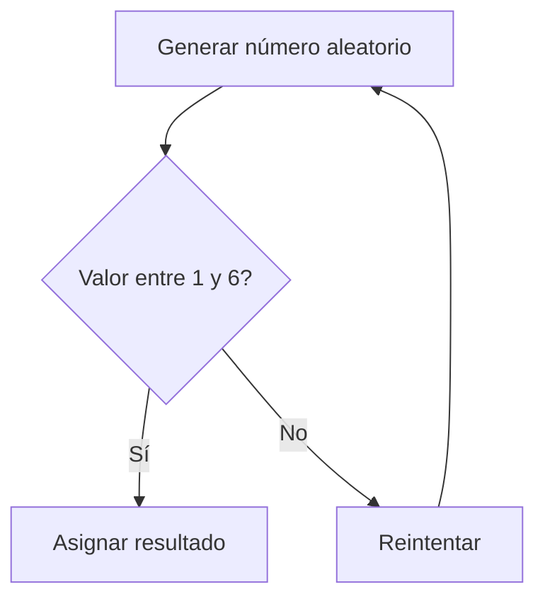

# Números aleatorios

## 1. Definición

Los números aleatorios son valores que se generan sin seguir un patrón predecible. Se usan para simular situaciones, pruebas y análisis probabilísticos.

## 2. Explicación desarrollada

En muchos sistemas es útil estudiar eventos que no se pueden predecir exactamente. Por eso se utilizan números aleatorios para simular probabilidades, situaciones de riesgo o decisiones variables. La idea central es que cada valor tenga una posibilidad de aparecer sin depender de un orden previo.

## 3. Características principales

- No siguen un patrón evidente.
- Se usan en simulaciones y análisis.
- Pueden representar incertidumbre.
- Son útiles para evaluar probabilidades.

## 4. Objetivos y utilidad

- Simular situaciones reales.
- Analizar riesgos o probabilidades.
- Generar variedad en pruebas y ejercicios.

## 5. Ejemplo práctico

Se puede simular el lanzamiento de un dado con números aleatorios. Cada valor del 1 al 6 tiene la misma probabilidad de aparecer.

## 6. Diagrama

## 7. Conclusión

Los números aleatorios permiten incluir la incertidumbre en los modelos. Son esenciales para simular procesos reales donde no todo puede predecirse.

## Temas relacionados

- [Teoría de modelos](../teoria-de-modelos/README.md)
- [Diagramas y herramientas](../diagramas-y-herramientas/README.md)
