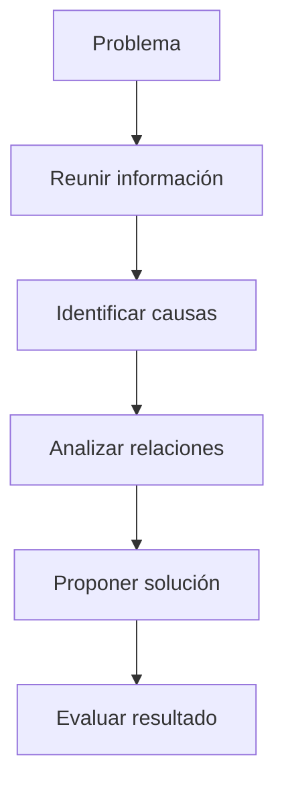

# Técnicas de análisis

## 1. Definición

Las técnicas de análisis permiten estudiar un problema, identificar sus elementos y comprender cómo funciona. Se usan para descomponer una situación compleja en partes más simples.

## 2. Explicación desarrollada

Cuando se enfrenta un problema, no siempre es necesario resolverlo de inmediato. Primero, se observa, se recopila información, se reconocen causas y se analizan datos. Esto ayuda a determinar qué está ocurriendo y qué decisiones conviene tomar.

Entre las técnicas más comunes se encuentran observación, entrevistas, clasificación de información y elaboración de diagramas.

## 3. Características principales

- Estudian el problema antes de resolverlo.
- Permiten separar elementos importantes de los secundarios.
- Ayudan a detectar relaciones entre causas y efectos.
- Sirven como base para la toma de decisiones.

## 4. Objetivos y utilidad

- Comprender mejor un sistema.
- Mejorar la calidad de las soluciones.
- Reducir errores por falta de información.

## 5. Ejemplo práctico

Si una empresa tarda en atender clientes, se puede analizar:

- cantidad de empleados,
- tiempo de atención,
- demanda del servicio,
- distribución del trabajo.

Con esa información se pueden detectar cuellos de botella.

## 6. Diagrama

## 7. Conclusión

Las técnicas de análisis permiten estudiar con orden y criterio. Son esenciales para transformar una dificultad en una solución clara y fundamentada.

## Temas relacionados

- [Ciclo de vida](../ciclo-de-vida/README.md)
- [Teoría de modelos](../teoria-de-modelos/README.md)
