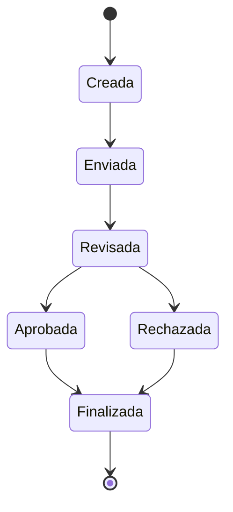

# Transición de estados

## 1. Definición

La transición de estados describe los cambios que puede sufrir un objeto, proceso o sistema según ciertas condiciones. Cada cambio representa un estado distinto.

## 2. Explicación desarrollada

Los sistemas no siempre permanecen estáticos. Un proceso puede pasar de un estado inicial a un estado intermedio y luego a uno final. Por ejemplo, un producto puede estar en estado "pendiente", luego "en proceso" y, después, "entregado".

La representación de estos cambios ayuda a identificar el orden de los eventos y cómo se activa cada paso.

## 3. Características principales

- Tiene estados definidos.
- Los cambios se producen por eventos o condiciones.
- Puede representarse gráficamente.
- Ayuda a modelar procesos dinámicos.

## 4. Objetivos y utilidad

- Comprender secuencias de eventos.
- Identificar errores o bloqueos.
- Mejorar la planificación de procesos.

## 5. Ejemplo práctico

Una solicitud de préstamo puede pasar por estas fases:

- creada,
- enviada,
- revisada,
- aprobada o rechazada,
- finalizada.

## 6. Diagrama

## 7. Conclusión

La transición de estados permite describir la evolución de un sistema con precisión y claridad. Es una herramienta valiosa para analizar procesos reales.

## Temas relacionados

- [Ciclo de vida](../ciclo-de-vida/README.md)
- [Teoría de modelos](../teoria-de-modelos/README.md)
