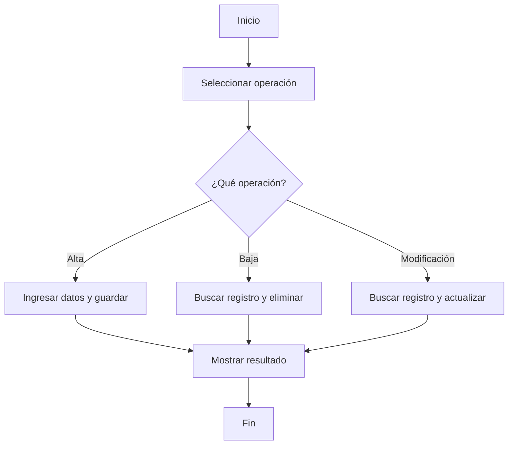

# ABM: Alta, Baja y Modificación

## 1. Definición

ABM significa **Alta, Baja y Modificación**. Son operaciones básicas que permiten administrar los registros guardados en un sistema.

## 2. Operaciones

- **Alta:** incorporar un registro nuevo.
- **Baja:** eliminar un registro existente.
- **Modificación:** cambiar los datos de un registro que ya está guardado.

En muchos sistemas también se incluye la consulta o lectura de registros. En ese caso suele hablarse de CRUD: crear, leer, actualizar y eliminar. ABM se refiere específicamente a las tres operaciones indicadas en su nombre.

## 3. Ejemplo práctico

En un sistema de alumnos:

- Alta: registrar a un alumno nuevo.
- Baja: eliminar el registro de un alumno que ya no pertenece al sistema.
- Modificación: corregir su dirección o número de teléfono.

## 4. Flujo general

## 5. Importancia

Estas operaciones permiten mantener actualizada la información de una aplicación. Antes de eliminar o modificar datos, el sistema debe identificar correctamente el registro y validar la información ingresada.

## Para recordar

Alta agrega, baja elimina y modificación actualiza un registro existente.

## Tema relacionado

- [Entidad-relación](../entidad-relacion/README.md)
