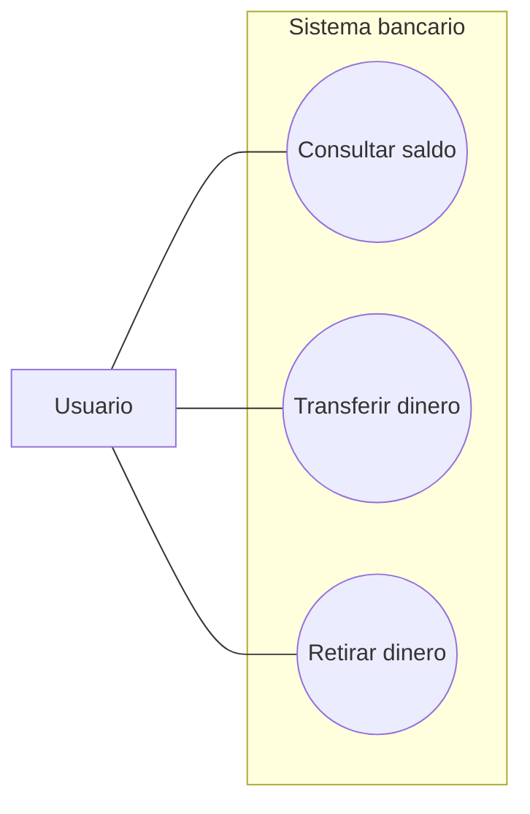

# Casos de uso

## 1. Definición

Los casos de uso representan las funciones que un sistema ofrece a sus usuarios o a otros sistemas externos. Se utilizan para describir qué puede hacer cada actor, sin explicar el código interno.

## 2. Elementos principales

- **Actor:** persona, organización u otro sistema externo que interactúa con el sistema.
- **Caso de uso:** función o acción que el actor puede realizar.
- **Relación:** conexión que muestra la participación del actor en una función.
- **Límite del sistema:** rectángulo que delimita las funciones incluidas en el sistema.

## 3. Ejemplo: sistema bancario

Un usuario puede consultar su saldo, transferir dinero o retirar dinero.

## 4. ¿Para qué sirven?

Ayudan a identificar los requisitos funcionales, es decir, las acciones que el sistema debe permitir realizar. También facilitan la comunicación entre quienes solicitan el sistema y quienes lo desarrollan.

## 5. Para recordar

El actor interactúa con el sistema y el caso de uso representa una función que el sistema ofrece.

## Tema relacionado

- [Diagramas de flujo](../diagramas-de-flujo/README.md)
