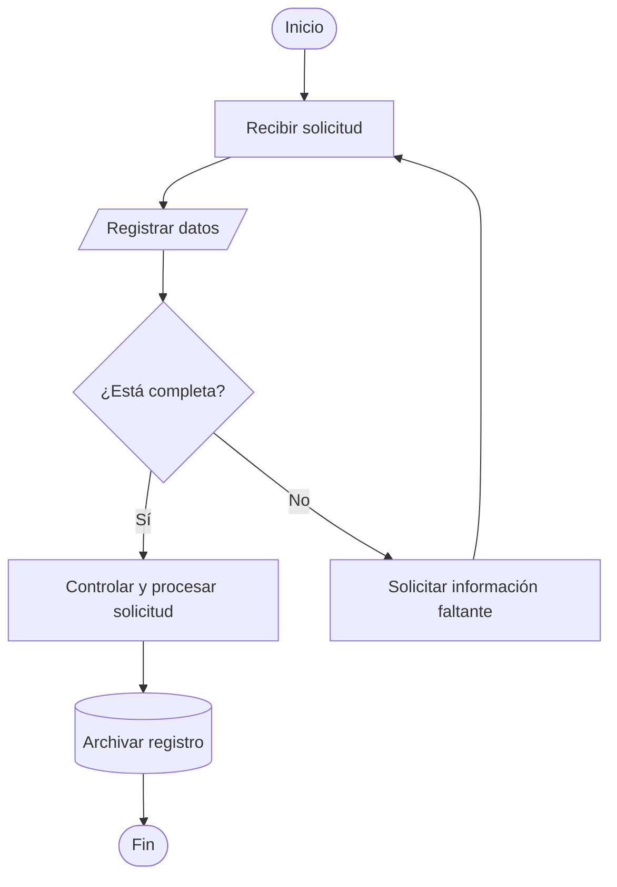

# Cursogramas

## 1. Definición

Un **cursograma** es una representación gráfica de un procedimiento administrativo o de trabajo. Muestra, en el orden en que ocurren, las operaciones, controles, decisiones, documentos y traslados que forman parte de un proceso.

A diferencia de un diagrama que se concentra solamente en un algoritmo, el cursograma permite observar también quién realiza cada tarea y qué documentos o registros intervienen.

## 2. Utilidad

- Comprender y comunicar cómo se realiza un procedimiento.
- Identificar responsables, tareas y documentos que intervienen.
- Detectar pasos repetidos, demoras, errores o controles innecesarios.
- Reconocer dónde se genera, recibe, consulta o archiva información.
- Proponer mejoras y dejar registro de cómo debería funcionar el proceso.

## 3. Elementos de un cursograma

- **Operaciones:** tareas que transforman, generan o completan información.
- **Controles:** verificaciones para comprobar que los datos o documentos sean correctos.
- **Documentos:** formularios, comprobantes, solicitudes o informes.
- **Archivos o registros:** lugares donde se guarda información.
- **Traslados:** movimiento de documentos o información entre sectores.
- **Responsables o sectores:** personas o áreas que realizan las actividades.
- **Líneas de flujo:** conectan los símbolos y muestran el recorrido.

## 4. Símbolos: denominación y descripción

Los símbolos pueden variar según la norma o convención que utilice la institución. Estos son símbolos habituales en la enseñanza de cursogramas y diagramas de procesos:

| Denominación | Representación habitual | Descripción |
|---|---|---|
| Inicio / fin | Óvalo o terminador | Indica dónde comienza o termina el procedimiento. |
| Operación | Círculo | Representa una tarea o actividad que se realiza. |
| Control / inspección | Cuadrado | Indica una revisión o verificación de datos, documentos o resultados. |
| Operación y control | Círculo dentro de un cuadrado | Señala que en una misma etapa se realiza una tarea y se controla su resultado. |
| Documento | Rectángulo con borde inferior ondulado | Representa un documento que se recibe, consulta o genera. |
| Archivo | Triángulo invertido u otro símbolo de archivo, según la convención | Indica que un documento o registro queda guardado. |
| Traslado | Flecha | Muestra el movimiento de documentos, información o elementos entre sectores o etapas. |
| Conector | Círculo pequeño | Permite continuar el recorrido en otra parte del gráfico sin cruzar demasiadas líneas. |
| Decisión | Rombo | Representa una condición que puede producir caminos diferentes, por ejemplo “Sí” o “No”. |

**Importante:** algunos símbolos cambian de forma entre normas y tipos de cursogramas. Para una entrega escolar, se debe respetar la simbología indicada por el docente o por la guía utilizada en clase.

## 5. Técnicas para elaborar un cursograma

1. **Seleccionar el procedimiento:** definir qué proceso se va a representar y dónde comienza y termina.
2. **Relevar información:** observar el trabajo, consultar a los responsables y revisar formularios o registros.
3. **Identificar participantes:** anotar qué personas o sectores intervienen.
4. **Ordenar las actividades:** escribir las operaciones, controles, decisiones, documentos y traslados en la secuencia real.
5. **Elegir la simbología:** utilizar los símbolos correspondientes y mantener el mismo criterio en todo el gráfico.
6. **Dibujar el recorrido:** conectar las actividades con líneas o flechas y señalar los caminos alternativos.
7. **Verificar el resultado:** recorrer el gráfico con quienes conocen el procedimiento y corregir omisiones o pasos incorrectos.

### Formas de organizar la representación

- **Por sectores o responsables:** permite ver qué área realiza cada actividad y cuándo pasa el trabajo a otra.
- **En secuencia temporal:** ordena los pasos desde el inicio hasta el final.
- **Con documentos identificados:** permite seguir el recorrido de formularios y comprobantes a través del proceso.

## 6. Ejemplo: recepción de una solicitud

El ejemplo muestra cómo se recibe y registra una solicitud. Si faltan datos, se pide completar la información; si está completa, se controla, procesa y archiva.

## 7. Para recordar

El cursograma permite visualizar un procedimiento completo. Sus símbolos identifican operaciones, controles, documentos, archivos y traslados; las técnicas de relevamiento y verificación ayudan a que el gráfico represente correctamente el trabajo.

## Temas relacionados

- [Diagramas de flujo](../diagramas-de-flujo/README.md)
- [Documentación de un proyecto](../documentacion-proyecto/README.md)
- [Documentación de relevamiento y diseño](../etapas-documentacion/README.md)
