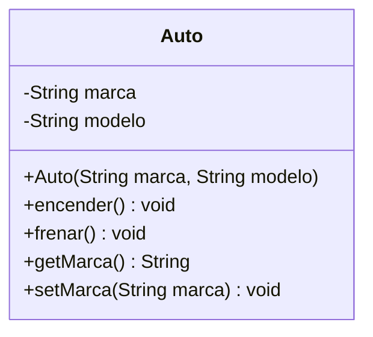

# Diagrama de clases

## 1. Definición

El diagrama de clases es una representación de la estructura de un programa orientado a objetos. Muestra las clases, sus atributos, sus métodos y las relaciones que existen entre ellas.

## 2. Partes de una clase

En UML, una clase suele representarse con un rectángulo dividido en tres sectores:

1. Nombre de la clase.
2. Atributos y sus tipos de datos.
3. Métodos u operaciones.

## 3. Conceptos importantes

- **Creación de clases:** definir una plantilla para construir objetos.
- **Paquetes:** agrupan clases relacionadas para organizar el código.
- **Instancia:** objeto creado a partir de una clase.
- **Atributos:** propiedades o datos de un objeto.
- **Tipos:** indican qué clase de dato almacena un atributo, por ejemplo `String`, `Integer` o `Boolean`.
- **Visibilidad:** indica desde dónde se puede acceder a un atributo o método. Público (`+`) permite el acceso desde otras clases; privado (`-`) restringe el acceso a la propia clase; protegido (`#`) permite el acceso desde la clase y sus clases derivadas.
- **Get:** método que permite consultar el valor de un atributo.
- **Set:** método que permite modificar el valor de un atributo.
- **Constructor:** método especial que se ejecuta al crear un objeto y permite inicializar sus atributos.

## 4. Ejemplo

La clase `Auto` tiene dos atributos privados y métodos públicos para realizar acciones o consultar y modificar datos.

## 5. Relación con el código

El diagrama sirve como plano antes de programar. Luego, cada clase del diseño puede implementarse en un lenguaje orientado a objetos, como Java.

## Para recordar

El diagrama de clases describe cómo está organizado el programa; no muestra el recorrido paso a paso de una ejecución.

## Temas relacionados

- [POO](../programacion-orientada-a-objetos/README.md)
- [Herencia](../herencia/README.md)
