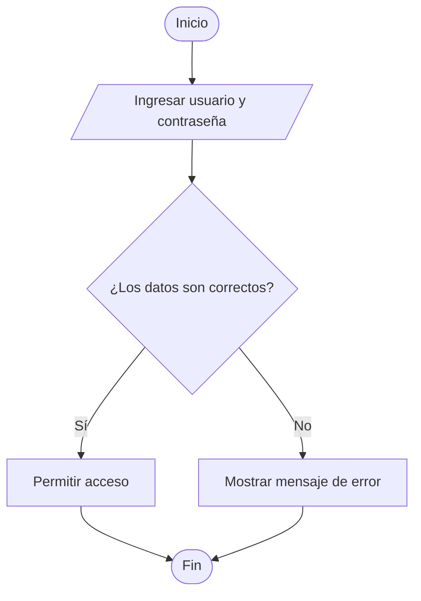

# Diagramas de flujo

## 1. Definición

Un diagrama de flujo es una representación gráfica de los pasos de un algoritmo o proceso. Utiliza símbolos conectados por flechas para mostrar acciones, decisiones, entradas y salidas.

## 2. Símbolos habituales

- **Óvalo:** inicio o fin.
- **Rectángulo:** proceso o acción.
- **Rombo:** decisión o condición, con caminos posibles.
- **Paralelogramo:** entrada o salida de datos.
- **Flechas:** dirección y orden del flujo.

## 3. Ejemplo: validar un inicio de sesión

Primero se ingresan los datos. El sistema los comprueba y, según el resultado, permite el acceso o muestra un error.

## 4. ¿Para qué sirve?

Permite comprender un algoritmo antes de programarlo, comunicar cómo funciona un procedimiento y detectar pasos innecesarios o errores en la lógica.

## 5. Para recordar

Un diagrama de flujo muestra el orden de los pasos y las decisiones de un proceso mediante símbolos convencionales.

## Tema relacionado

- [Cursogramas](../cursogramas/README.md)
