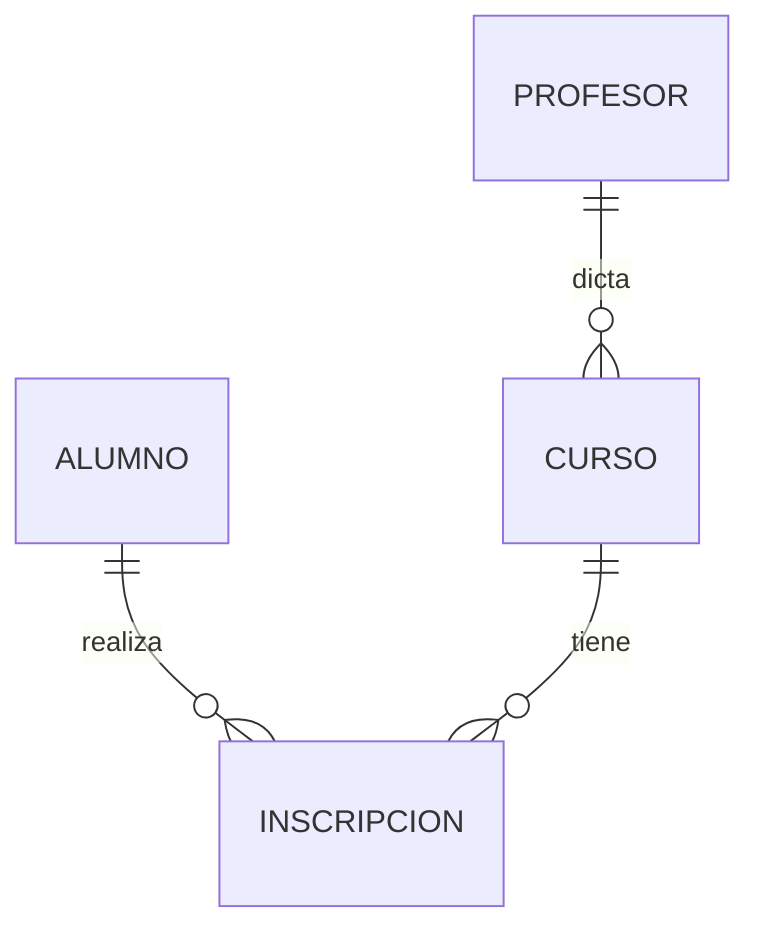

# Entidad-relación

## 1. Definición

El modelo entidad-relación en 7.º año se usa para diseñar la estructura de datos de un sistema de información, incorporando relaciones más complejas y una mayor atención a los datos.

## 2. Explicación desarrollada

También en este nivel, se trabaja con entidades, atributos y relaciones. Pero se busca una organización más formal para poder luego pasar a una base de datos o a una aplicación.

Se diferencian conceptos como:

- entidades: sujetos o cosas del sistema,
- atributos: datos de cada entidad,
- relaciones: conexiones entre entidades.

## 3. Características principales

- Es esencial en diseño de bases de datos.
- Permite representar relaciones entre tablas o clases.
- Ayuda a planificar la estructura de información.

## 4. Objetivos y utilidad

- Organizar datos de forma lógica.
- Evitar redundancias.
- Mejorar la claridad del diseño.

## 5. Ejemplo práctico

En un sistema de gestión escolar:

- alumno,
- curso,
- profesor,
- inscripción.

Relaciones:

- un profesor dicta varios cursos,
- un alumno puede inscribirse en muchos cursos,
- un curso puede tener muchos alumnos.

## 6. Diagrama

- [Diagrama de clases](../diagramas-de-clases/README.md)
- [5.º año: entidad-relación](../../5to-anio/entidad_relacion/README.md)
