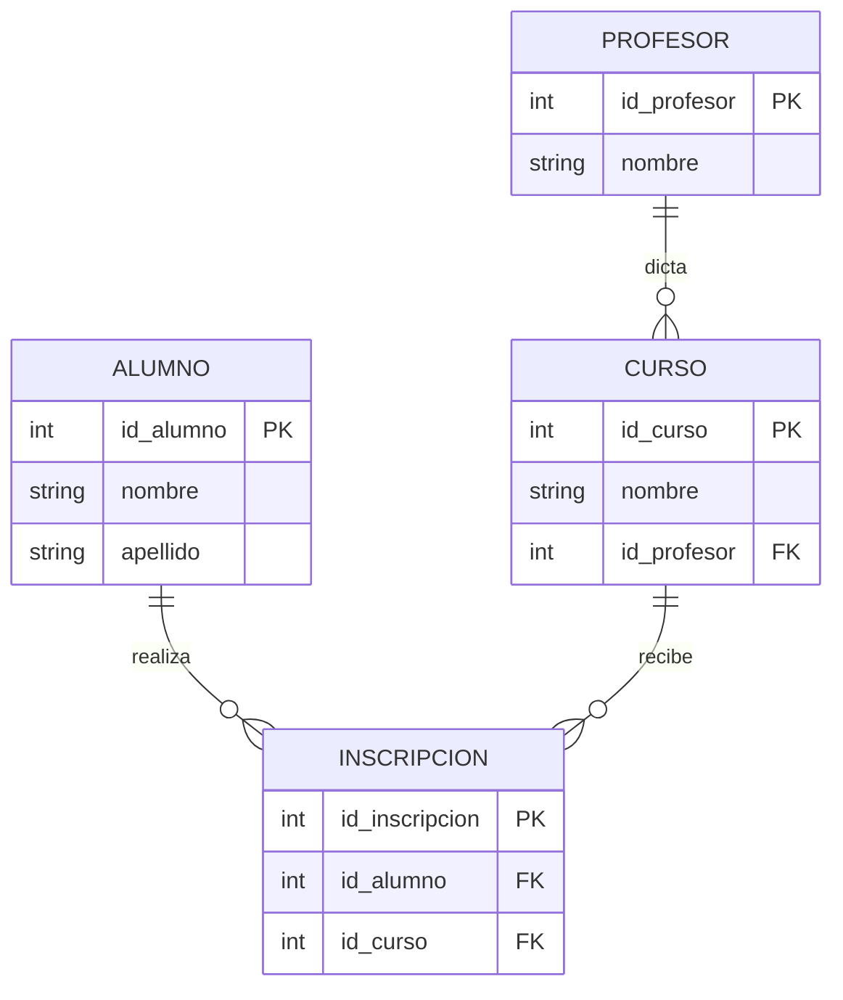

# Diagrama entidad-relación (DER)

## 1. Definición

El diagrama entidad-relación representa de manera gráfica la información que necesita un sistema y las relaciones entre sus elementos. Se utiliza como guía para diseñar una base de datos.

## 2. Elementos principales

- **Entidad:** elemento del que se desea guardar información, por ejemplo `ALUMNO` o `CURSO`.
- **Atributo:** característica de una entidad, como nombre, fecha de nacimiento o código.
- **Relación:** asociación entre dos o más entidades.
- **Clave primaria (PK):** atributo, o conjunto de atributos, que identifica de forma única cada registro.
- **Clave foránea (FK):** atributo que referencia la clave primaria de otra tabla y permite relacionarlas.

## 3. Cardinalidades

- **Uno a uno (1:1):** un registro de una entidad se relaciona con uno de la otra.
- **Uno a muchos (1:N):** un registro puede relacionarse con varios de la otra entidad.
- **Muchos a muchos (N:M):** varios registros de una entidad pueden relacionarse con varios de la otra. Al llevarlo a tablas relacionales, normalmente se resuelve mediante una tabla intermedia.

## 4. Ejemplo: sistema escolar

Un alumno puede realizar varias inscripciones y cada inscripción corresponde a un curso. La inscripción permite registrar la relación entre alumno y curso.

## 5. ¿Para qué sirve?

Permite planificar qué datos se almacenarán, detectar relaciones necesarias y evitar duplicaciones o inconsistencias antes de construir la base de datos.

## 6. Para recordar

La entidad representa aquello sobre lo que se guarda información; los atributos describen sus características; PK identifica registros y FK conecta tablas.

## Temas relacionados

- [ABM](../abm/README.md)
- [Diagrama de clases](../diagramas-de-clases/README.md)
