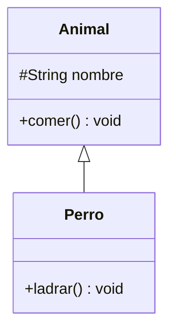

# Herencia

## 1. Definición

La herencia es una característica de la programación orientada a objetos que permite crear una clase nueva a partir de otra. La clase nueva puede reutilizar atributos y métodos de la clase original y agregar características propias.

## 2. Conceptos

- **Superclase o clase padre:** clase de la que se heredan características.
- **Subclase o clase hija:** clase que recibe los atributos y métodos heredables de la superclase.
- **Reutilización:** permite evitar repetir código que varias clases necesitan.

## 3. Ejemplo en Java

```java
class Animal {
    protected String nombre;

    public Animal(String nombre) {
        this.nombre = nombre;
    }

    public void comer() {
        System.out.println(nombre + " está comiendo");
    }
}

class Perro extends Animal {
    public Perro(String nombre) {
        super(nombre);
    }

    public void ladrar() {
        System.out.println("Guau");
    }
}
```

`Animal` es la superclase y `Perro` es la subclase. `Perro` hereda el atributo `nombre` y el método `comer()`, y agrega `ladrar()`.

## 4. Diagrama



## 5. ¿Para qué sirve?

Sirve para organizar clases relacionadas y reutilizar código. No conviene usar herencia solamente para evitar escribir código: debe existir una relación lógica entre la clase general y la más específica.

## Para recordar

La subclase especializa a la superclase: conserva lo heredado y puede sumar sus propios atributos y métodos.

## Tema relacionado

- [POO](../programacion-orientada-a-objetos/README.md)
