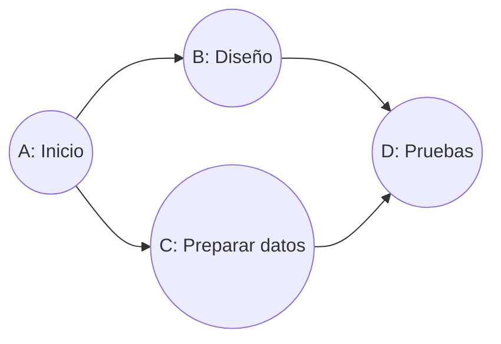

# Diagramas PERT y Gantt

## 1. Definición

PERT y Gantt son herramientas que permiten planificar y controlar las actividades de un proyecto. Ayudan a organizar tareas, tiempos y dependencias.

## 2. Diagrama PERT

El diagrama PERT representa las actividades de un proyecto y las relaciones de dependencia entre ellas. Permite identificar qué tareas deben realizarse primero y cuáles pueden comenzar cuando otras hayan terminado.

### Ejemplo simplificado

En este ejemplo, las pruebas comienzan cuando finalizaron tanto el diseño como la preparación de datos.

## 3. Diagrama de Gantt

El diagrama de Gantt es un gráfico de barras que muestra las tareas de un proyecto distribuidas en un calendario. Cada barra representa cuándo comienza una actividad y cuánto tiempo dura.

### Ejemplo ilustrativo

| Actividad | Semana 1 | Semana 2 | Semana 3 | Semana 4 |
|---|:---:|:---:|:---:|:---:|
| Relevamiento | █ | | | |
| Diseño | | █ | █ | |
| Programación | | | █ | █ |
| Pruebas | | | | █ |

*La tabla es un ejemplo simplificado de planificación, no un cronograma de un proyecto real.*

## 4. Diferencias

- **PERT:** destaca las dependencias y el orden necesario entre actividades.
- **Gantt:** destaca la distribución de las tareas a lo largo del tiempo.

Ambas herramientas pueden utilizarse juntas: PERT ayuda a organizar la secuencia y Gantt permite visualizar el calendario.

## 5. Para recordar

PERT muestra qué actividades dependen de otras; Gantt muestra cuándo se realizan y cuánto duran.

## Temas relacionados

- [Documentación de un proyecto](../documentacion-proyecto/README.md)
- [Ciclo de vida del sistema - 5.º año](../../5to-anio/ciclo-de-vida/README.md)
