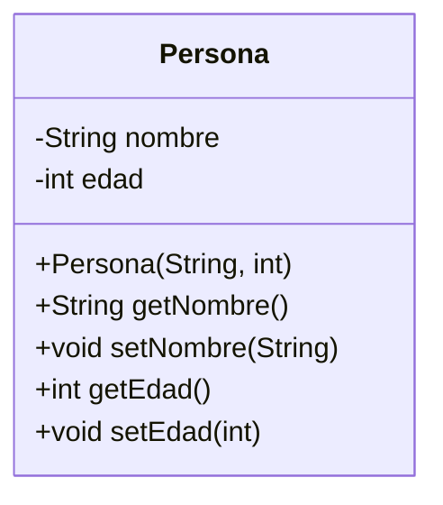

# Programación orientada a objetos

## 1. Definición

La programación orientada a objetos (POO) es un paradigma que organiza el código en objetos, cada uno con sus propios atributos y comportamientos.

## 2. Explicación desarrollada

En lugar de pensar solo en funciones, la POO representa entidades del mundo real o del problema a resolver. Un objeto puede ser, por ejemplo, un alumno, un producto o un usuario. Cada objeto tiene datos y acciones que puede realizar.

## 3. Características principales

- Encapsulamiento.
- Abstracción.
- Herencia.
- Polimorfismo.
- Reutilización de código.

## 4. Objetivos y utilidad

- Organizar mejor el código.
- Resolver problemas complejos con mayor claridad.
- Facilitar el mantenimiento del software.

## 5. Ejemplo práctico en Java

```java
class Persona {
    private String nombre;
    private int edad;

    public Persona(String nombre, int edad) {
        this.nombre = nombre;
        this.edad = edad;
    }

    public String getNombre() {
        return nombre;
    }

    public void setNombre(String nombre) {
        this.nombre = nombre;
    }

    public int getEdad() {
        return edad;
    }

    public void setEdad(int edad) {
        this.edad = edad;
    }
}
```

## 6. Diagrama de clases



## 7. Conclusión

La programación orientada a objetos organiza el trabajo en piezas reutilizables y fáciles de entender. Es una base muy importante en la programación moderna.

## Temas relacionados

- [Diagramas de clases](../diagramas-de-clases/README.md)
- [Herencia y ArrayList](../herencia-y-arraylist/README.md)
